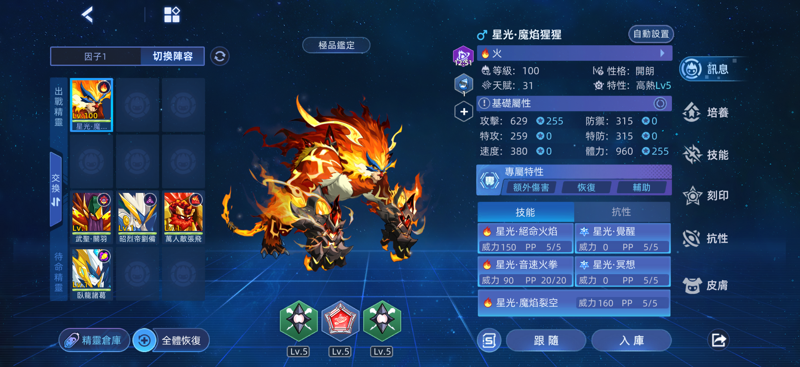
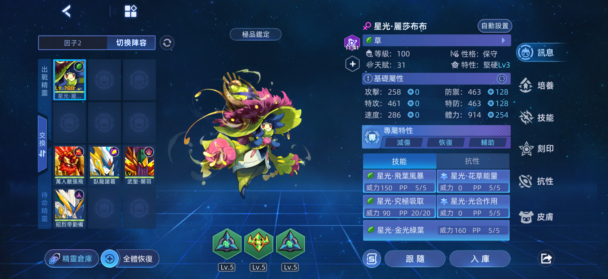
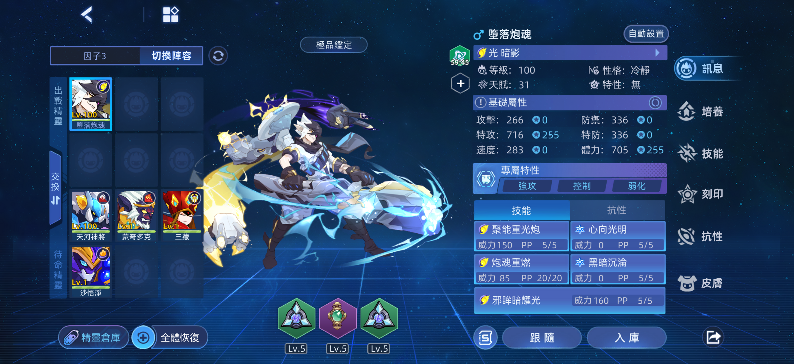
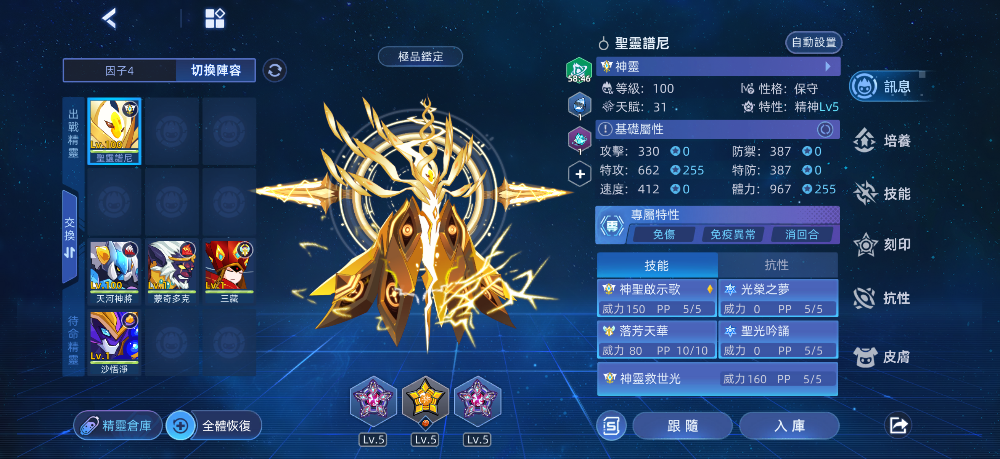
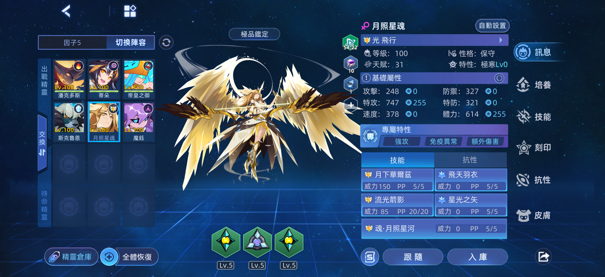
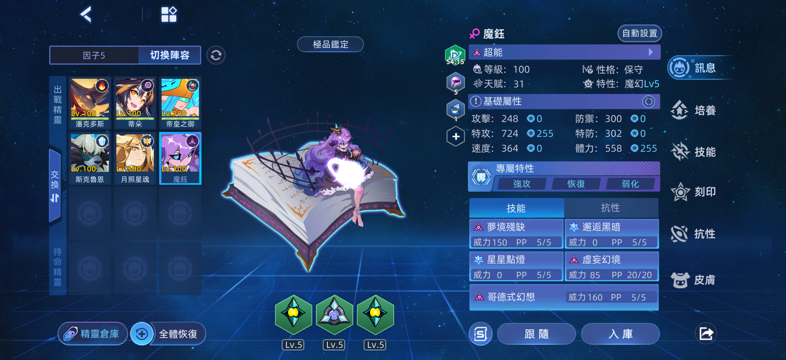

## 第一關 📌

套裝: 漆黑、漫遊者-AH

稱號: 吉光鳳羽

Buff: 桃園、紫火、全面提升藥劑

攻略: 星光魔焰猩猩，一直第五技能即可

## 第二關 📌

套裝: 漆黑、漫遊者-AH

稱號: 吉光鳳羽

Buff: 紫火

攻略: 星光麗莎布布，第五技能將 Boss 血量削至 1/3 後，用飛葉風暴斬殺

## 第三關 📌

套裝: 漆黑、漫遊者-AH

稱號: 吉光鳳羽

Buff: 綠火

攻略: 四倍克制屬性強攻手，直接用技能輸出即可

## 第四關 📌

套裝: 漆黑、漫遊者-AH

稱號: 吉光鳳羽

Buff: 綠火、全面提升藥劑、減傷珠

攻略: 普尼吸收強化，用第五技能輸出即可

## 第五關 📌

套裝: 銀翼騎士、漫遊者-AH

稱號: 吉光鳳羽

Buff: 綠火、全面提升藥劑、特攻能量珠

攻略: 冰潘以及強攻手需要壓血量，火潘、蒂朵、表姐接續自爆；冰潘上場吃 pp 藥空回合；最後用強攻手收尾


第五關 Boss 有 40% 概率復活。如果兩次強攻都復活了，需要重新再打一次。


