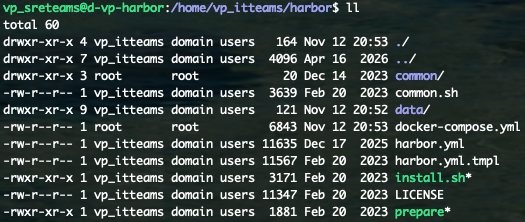
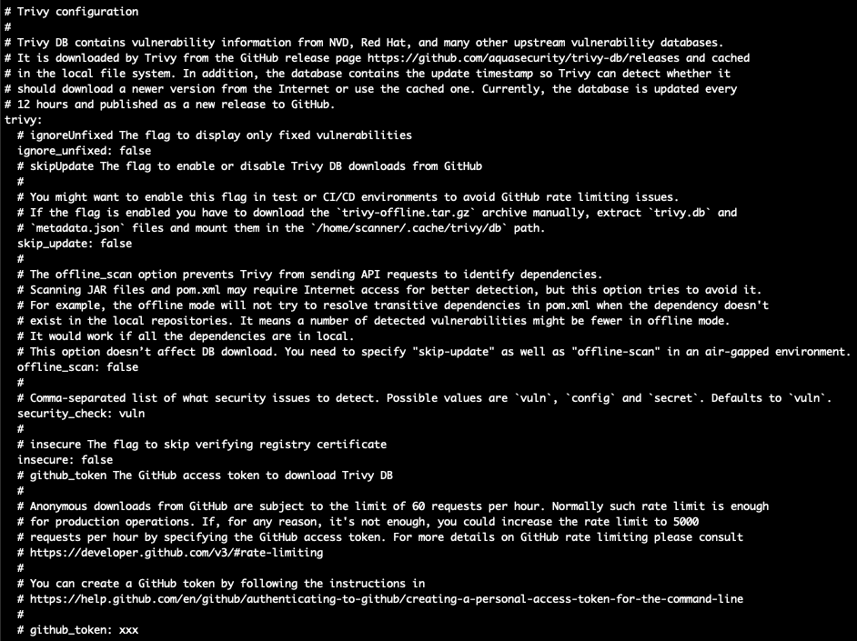
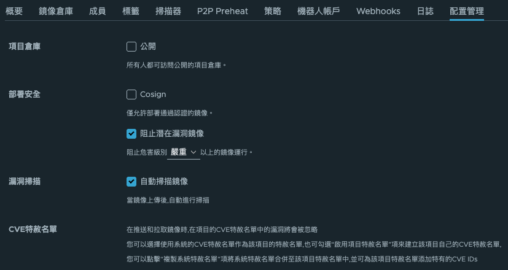
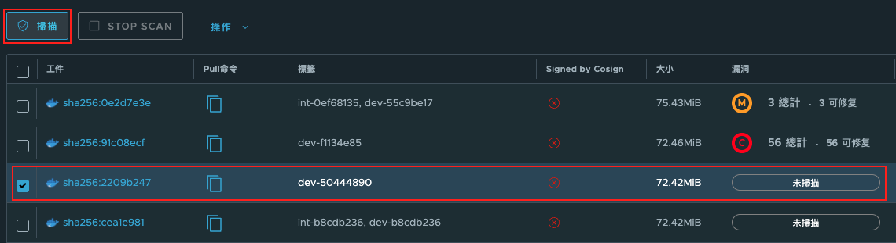

## 前言 🔖

最近因為資訊安全事件頻傳，之前其實已經會針對容器的 image 限制權限，但是因為部署的程式碼可能使用的到的套件版本會存在安全漏洞造成風險，因此才開始研究弱點掃描工具 🧰

有一個工具叫做 Trivy，是開源且免費的弱點掃描工具，可以用來檢查容器映像檔中的安全漏洞。而且 harbor 也整合了 Trivy。可以透過參數，直接在 harbor 中啟用弱點掃描功能，讓每次的映像檔上傳都能自動進行安全檢查。

## Harbor 中啟用 Trivy 弱點掃描 🛡️

首先，進入到 harbor 的 VM 內部找到 harbor 的 安裝時的配置檔案目錄，進入後，使用指令查看裡面有什麼檔案，通常會像下圖的目錄結構一樣:



因為之前已經有建置過 harbor，我們可以先檢查 `harbor.yml.tmpl` 配置檔案，檢查 `trivy` 區塊內的設置是否正確，可以參考下圖:



確認配置沒有問題以後，先把服務停止

```bash
docker-compose down
```

接著，重新執行安裝指令，啟動 harbor 服務:

```bash
./install.sh --with-trivy
```

順利重新安裝啟動以後，回到 harbor 的網頁介面。找到要管理的映像檔項目，查看配置管理，可以看到漏洞掃描在還沒有啟用 trivy 的情況下是灰色的，現在看到已經變成可用的狀態了。接著只要設定我們需要的掃描策略，就可以自動進行弱點掃描了。



開啟後，之後推上去的映像檔就會自動進行弱點掃描，以前推送的映像檔則需要手動觸發掃描。

