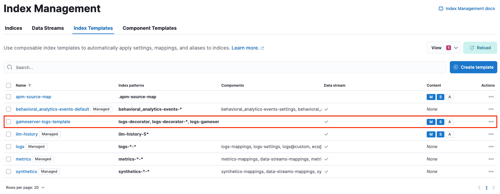
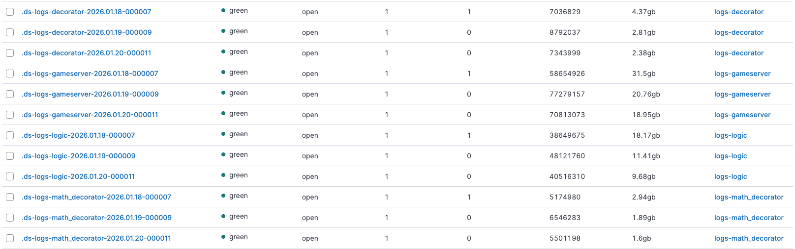

## 前言🔖

最近有幫公司重新建立一套 Elastic 的 Log 系統，之前的團隊依賴 VM 內部的排程任務來做 Index 的刪除與管理，這樣的方式雖然能達到目的，但卻不夠彈性且容易出錯。後來發現 Elastic 官方提供的 Data Streams 功能，可以自動化管理 Index 的生命週期，讓我們能更輕鬆地維護 Log 系統。

## Data Streams 簡介📃

Data Streams 是 Elastic Stack 中的一個功能，主要用於處理時間序列資料，如日誌、指標等。它允許我們將資料自動分割成多個 Index，並根據設定的生命週期策略自動管理這些 Index 的刪除和轉換。下面會開始介紹如何使用 Data Streams 來自動化管理 Index 的生命週期。

## 建立 Lifecycle Policy🛠️

第一步，我們需要建立一個 Index Lifecycle Management (ILM) 策略，來定義 Index 的生命週期。以下是一個範例策略，設定 Index 在 30 天後刪除：

```json
PUT _ilm/policy/my-lifecycle-policy
{
  "policy": {
    "phases": {
      "hot": {
        "actions": {
          "rollover": {
            "max_size": "50gb",
            "max_age": "7d"
          }
        }
      },
      "delete": {
        "min_age": "30d",
        "actions": {
          "delete": {}
        }
      }
    }
  }
}
```

如果公司內部有建立 Elastic 的 API Domain，可以透過 API Domain 來執行上述的指令。例如：

```bash
curl -X PUT "https://your-api-domain/_ilm/policy/my-lifecycle-policy" -H 'Content-Type: application/json' -d'
{
  "policy": {
    "phases": {
      "hot": {
        "actions": {
          "rollover": {
            "max_size": "50gb",
            "max_age": "7d"
          }
        }
      },
      "delete": {
        "min_age": "30d",
        "actions": {
          "delete": {}
        }
      }
    }
  }
}'
```

## 建立 Component Template🔧

接下來，我們需要建立一個 Component Template，來定義 Data Stream 的 Mapping 和 Settings。以下是一個範例：

```json
PUT _component_template/my-logs-settings
{
  "template": {
    "settings": {
      "index.lifecycle.name": "my-lifecycle-policy", // 指定 ILM 策略，自動管理滾動與刪除
      "index.codec": "best_compression"
    }
  }
}

PUT _component_template/my-logs-mappings
{
  "template": {
    "mappings": {
      "properties": {
        "@timestamp": { "type": "date" }, // Data Stream 必須包含 @timestamp 欄位
        "message": { "type": "text" }
      }
    }
  }
}
```

## 建立 Index Template📂

接著，我們需要建立一個 Index Template，來將 Component Template 套用到 Data Stream 上。以下是一個範例：

```json
PUT _index_template/my-logs-template
{
  "index_patterns": ["logs-my-app-*"], // 匹配此模式的寫入將自動轉為 Data Stream
  "data_stream": {},                  // 啟動 Data Stream 功能
  "composed_of": [ "my-logs-settings", "my-logs-mappings" ], // 組合上面的組件
  "priority": 500
}
```

建立完成後，可以開啟 Kibana 的 Management 頁面，確認 Index Template 是否正確建立。如下圖所示：



### 補充說明⭐️

Index Template 使用 composed_of 屬性來組合多個 Component Template，也可以將設定直接寫在 Index Template 裡面。選擇不創建 Component Template 也是可以的。

## 測試 Data Stream🚀

當以上的準備工作都完成後，我們就可以開始測試 Data Stream 了。使用任何的 Log Agent 工具（如 Filebeat、Fluentd 等）將日誌資料寫入符合 Index Template 模式的 Index 名稱，例如 logs-my-app-000001。Elastic 會自動將其轉換為 Data Stream，並根據我們設定的 ILM 策略來管理 Index 的生命週期。

下圖是從 Server 收集到的日誌資料，並成功寫入 Data Stream：



### 補充說明⭐️

透過 Data Streams 管理的 Index，會加上 `.ds-` 前綴來區分一般的 Index。例如，logs-my-app-000001 會變成 .ds-logs-my-app-000001。在 Kibana 頁面上要打開 Include hidden indices 才能看到這些 Index。

## 結語📝

透過 Elastic 的 Data Streams 功能，我們可以輕鬆地自動化管理 Index 的生命週期，減少手動維護的工作量，並提高系統的穩定性和彈性。希望這篇文章能幫助大家更好地理解和使用 Data Streams 來管理日誌資料。

## 參考文獻📚

- [Elastic 官方文件 - Data Streams](https://www.elastic.co/docs/manage-data/data-store/data-streams)
- [Elastic 官方文件 - Set up a data stream](https://www.elastic.co/docs/manage-data/data-store/data-streams/set-up-data-stream)
